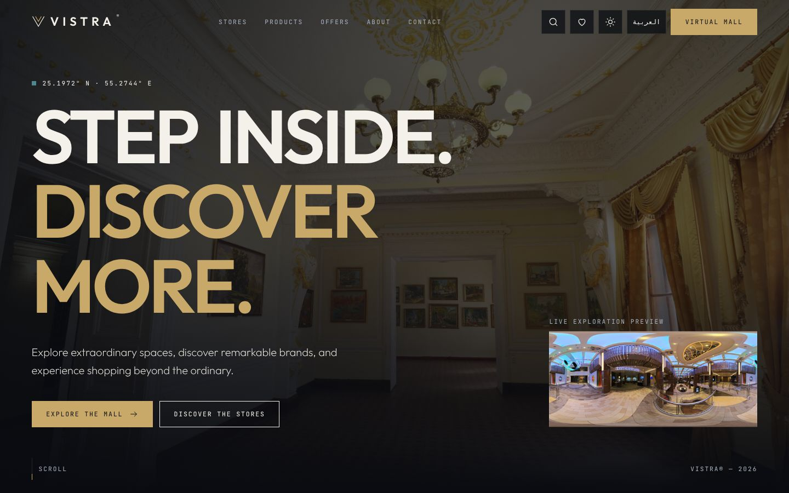
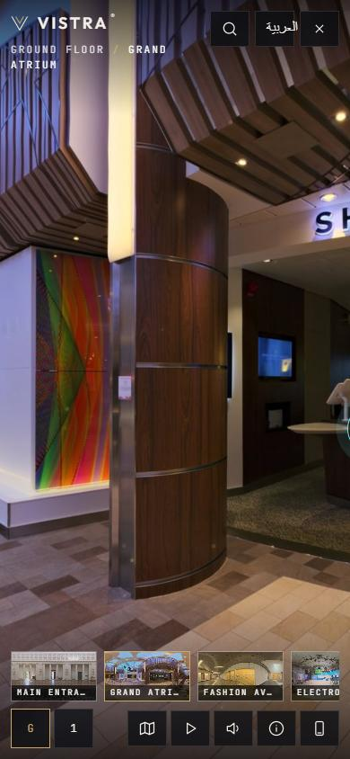
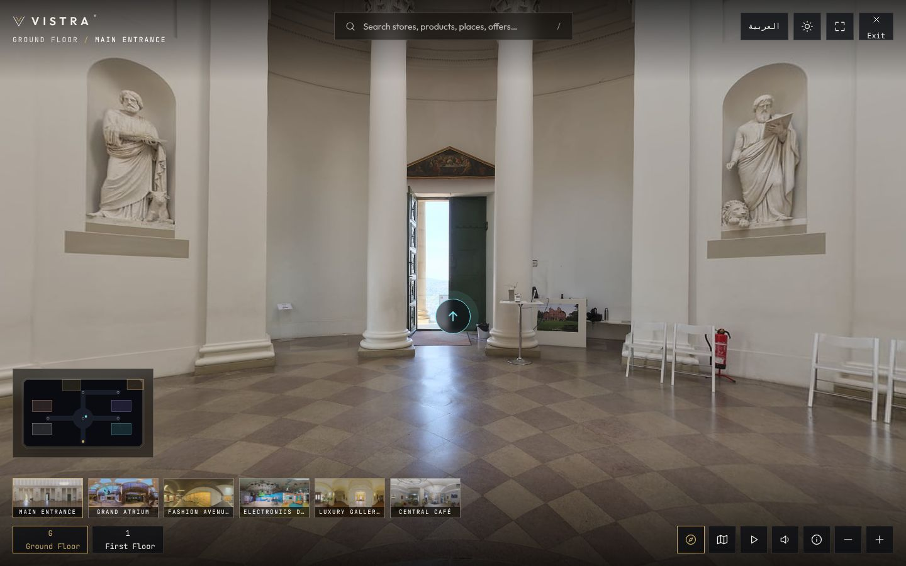
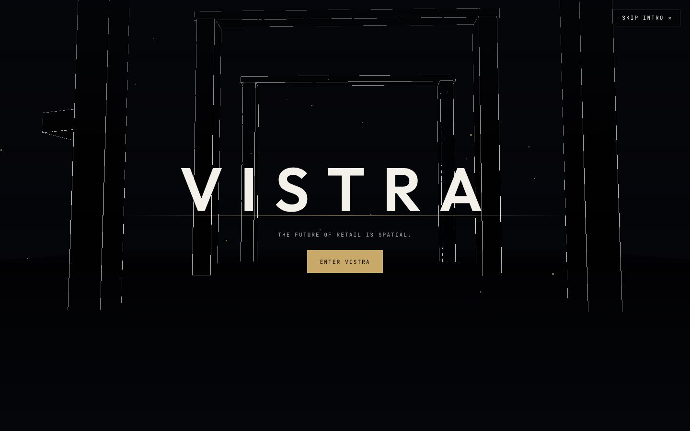
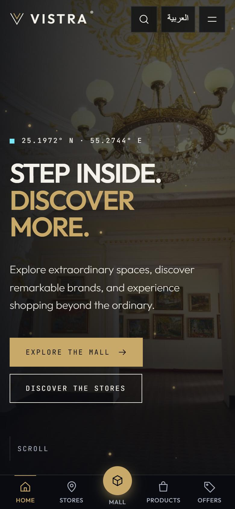
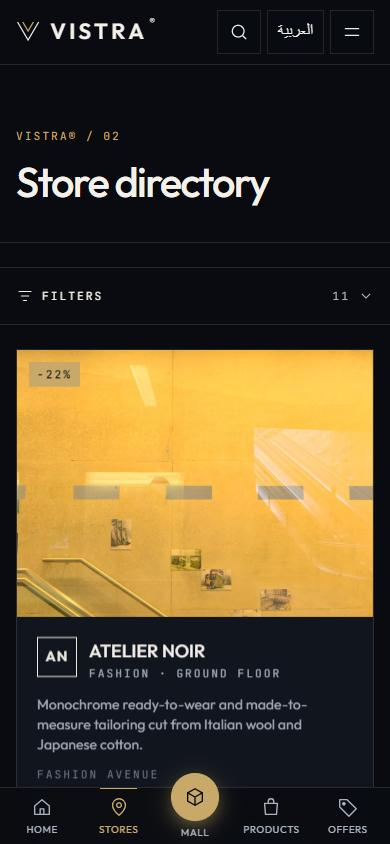
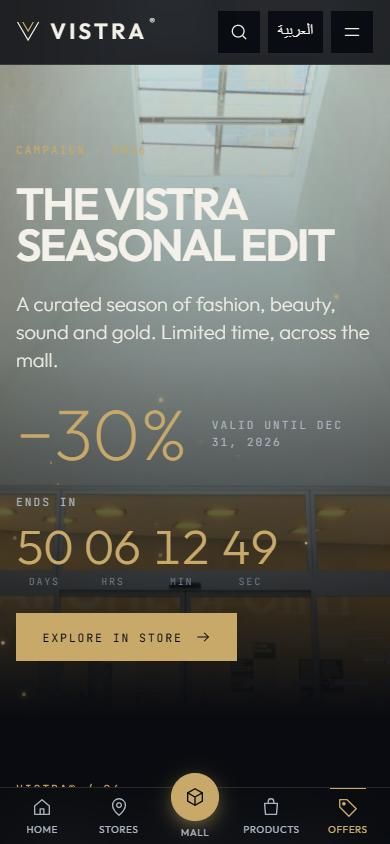
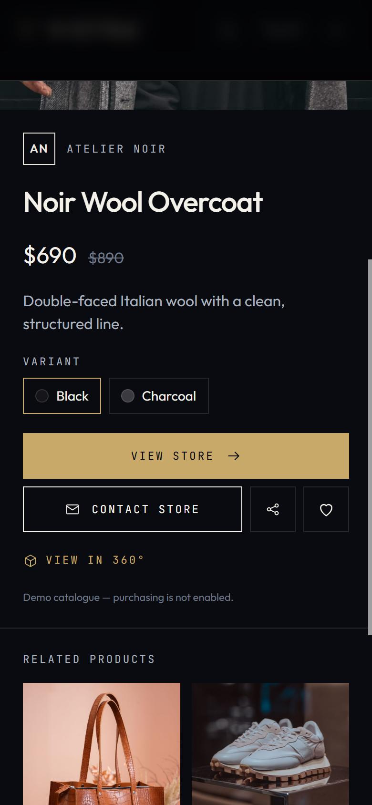

<div align="center">

# VISTRA® — Virtual Mall

### Walk through a shopping mall in 360°, find stores and products, and get directions between spaces

A bilingual (English LTR / Arabic RTL) virtual-mall platform built with Next.js 16, React 19 and TypeScript. Visitors explore 11 panoramic spaces over two floors, click hotspots to open stores and products, follow a floor map and route finder, and browse a regular store / product / offers directory.

[](https://nextjs.org)
[](https://react.dev)
[](https://www.typescriptlang.org)
[](https://tailwindcss.com)
<br>
[](https://photo-sphere-viewer.js.org)
[](https://threejs.org)
[](https://r3f.docs.pmnd.rs)
[](https://gsap.com)

**No live demo — run it locally ([Getting started](#getting-started)).**

**[Portfolio](https://new-portfolio-ashy-xi.vercel.app/)** ·
**[LinkedIn](https://www.linkedin.com/in/eslamraafat-dev/)** ·
**[Email](mailto:eslamraafat736@gmail.com)**

<br>



</div>

<table>
  <tr>
    <td width="33%"></td>
    <td width="67%">
      <br><br>
      
    </td>
  </tr>
  <tr>
    <td align="center"><sub>360° explorer on mobile (iPhone 13)</sub></td>
    <td align="center"><sub>360° explorer (<code>/experience</code>) · WebGL intro (React Three Fiber)</sub></td>
  </tr>
</table>

<sub>Screenshots are from a local production build (<code>npm run build && npm start</code>). A mobile view of the home page is in <a href="docs/screenshots/mobile.jpg"><code>docs/screenshots/mobile.jpg</code></a>.</sub>

---

## Contents

- [Overview](#overview)
- [Features](#features)
- [Motion and mobile design](#motion-and-mobile-design)
- [Tech stack](#tech-stack)
- [Architecture](#architecture)
- [Pages](#pages)
- [Project structure](#project-structure)
- [Getting started](#getting-started)
- [Replacing the demo panoramas](#replacing-the-demo-panoramas)
- [Hotspot editor (developer mode)](#hotspot-editor-developer-mode)
- [Assets and licensing](#assets-and-licensing)
- [Known limitations](#known-limitations)
- [Deployment](#deployment)
- [License](#license)
- [Author](#author)

## Overview

VISTRA is a concept project: a front end for a mall that wants shoppers to "walk" its corridors online before they visit. The mall, its 11 stores, 33 products and the offers are fictional demo data. The panoramas and photos are real, openly licensed images used as stand-ins (see [Assets and licensing](#assets-and-licensing)).

The data layer is written so real content can replace the demo: all UI code reads through one service module, and the panoramas, hotspots and products can be swapped without touching components.

## Features

### 360° explorer (`/experience`)

- 11 equirectangular panoramas across a **Ground Floor** and a **First Floor**, shown with Photo Sphere Viewer and its markers plugin.
- **Navigation hotspots** move you between connected spaces; **store hotspots** on shop fronts open a store panel with its products.
- **Floor map** (SVG drawn at runtime from data) shows where you are; a **route finder** (breadth-first search over the scene graph) gives turn-by-turn directions to any store or space, and the camera faces the right way when you arrive.
- **Guided tour** that visits every space and glances at up to three stores in each.
- Scene thumbnail strip, floor switcher, zoom, fullscreen, an info panel and optional ambient sound (synthesised with the Web Audio API, no audio files).
- Optional **gyroscope** control on supported phones (gyroscope plugin).
- The viewer is created once and loaded only on this route (`dynamic(..., { ssr: false })`); scene changes use `setPanorama()` and the neighbours of the current scene are pre-fetched.

### Site

- **WebGL intro** (React Three Fiber + GSAP) shown once per browser session, skippable with a button or `Escape`.
- Store directory, store pages, product explorer, product pages and an offers page with discounts and dates.
- **Global search** for stores, products, places and offers: press `/` to open it, use the arrow keys and Enter to pick a result.
- **Favourites** drawer saved in `localStorage`.
- English / Arabic with full RTL, light and dark themes, a custom cursor and magnetic buttons. Animations respect `prefers-reduced-motion`.
- Contact forms validate locally and are clearly marked as demo (nothing is sent).

### Motion and mobile design

Every effect is built to degrade: it switches off under `prefers-reduced-motion`, mouse-only effects never run on touch, and nothing hides content from people without JavaScript.

**Motion (all pages, English and Arabic)**

- **Home:** drifting gold dust in the hero that moves away from the pointer, an endless brand marquee, a scroll-progress bar, animated counters and spotlight-and-tilt store tiles.
- **Stores and products:** parallax store covers, pointer-lit cards, and a product image magnifier whose glow takes the colour of the selected variant.
- **Offers:** a live countdown to each offer's end date and a parallax campaign hero whose discount counts up.
- **360° explorer:** a cinematic scene transition (blurred destination, scanning line), hotspots that pop in one after another, and light ambient dust over the viewer.
- **About and contact:** story text that lights up word by word as you scroll, images that open from an inset frame, a copy-email button, a live open-now badge, an animated field underline and a drawn success check.

**Mobile**

- A thumb-reach **bottom dock** (Home, Stores, Mall, Products, Offers) on phones; from `lg` up the header carries the links.
- **Collapsible filters** on the store and product lists: one bar with the active-filter count and the result count, so results start almost immediately instead of a screen lower.
- Product details open as a **bottom sheet**; the header hides while scrolling down and returns on scroll up; store tiles use a two-column grid; the experience carousel shows a progress track.
- The 360° toolbar scrolls and fits down to 320 px wide (zoom buttons are hidden on touch, where pinch-to-zoom works), and it respects the notch and safe areas.
- Native **Share** button on stores and products (copies the link where the share sheet isn't available), larger touch targets and press feedback.
- Checked at 320 px and 375 px in both languages with no horizontal overflow on the main pages. Real-device testing (especially iOS Safari) has not been done.

<table>
  <tr>
    <td width="20%"></td>
    <td width="20%"></td>
    <td width="20%"></td>
    <td width="20%"></td>
    <td width="20%"></td>
  </tr>
  <tr>
    <td align="center"><sub>Home + dock</sub></td>
    <td align="center"><sub>Collapsed filters</sub></td>
    <td align="center"><sub>Live countdown</sub></td>
    <td align="center"><sub>Product sheet</sub></td>
    <td align="center"><sub>360° toolbar</sub></td>
  </tr>
</table>

<sub>Phone screenshots are from a local production build in a 390 × 844 browser viewport (not a physical device).</sub>

### SEO and metadata

- Per-page title, description and canonical URL through one helper ([`src/lib/site.ts`](src/lib/site.ts)), which also keeps the site name and a fallback Open Graph image on every page; store and product pages use their own image.
- `sitemap.xml` (fixed pages + every store and product) and `robots.txt` generated by the App Router; a web app manifest.
- Store and product pages are statically generated with `generateStaticParams`.
- Absolute URLs use `NEXT_PUBLIC_SITE_URL`, then the Vercel production domain if deployed there, then `http://localhost:3000` for local runs.

### Safety

- Hotspots are built with DOM APIs and `textContent`; no untrusted HTML is injected.

## Tech stack

| Layer | Tools |
| --- | --- |
| Framework | Next.js 16.4 (App Router), React 19.3 |
| Language | TypeScript 5 |
| Styling | Tailwind CSS 4, CSS custom properties for the light / dark themes |
| 360° viewer | `@photo-sphere-viewer/core` 5.15 + markers and gyroscope plugins |
| 3D | Three.js 0.187, React Three Fiber 9, drei 10 (intro scene) |
| Animation | GSAP 3.15 |
| Audio | Web Audio API (synthesised ambience) |
| Asset scripts | Node.js scripts in `scripts/` for hotspot anchors, panorama crops and product images |
| Quality | ESLint 9 (`eslint-config-next`) |

## Architecture

- **One source of truth.** `SCENES` in [`src/data/mall.ts`](src/data/mall.ts) declares which spaces connect to which, once. The navigation hotspots, the floor map's corridors, the route finder and the arrival camera direction are all derived from it, so the viewer, map, thumbnails and store panels always agree.
- **One data entry point.** UI code reads data only through [`src/data/service.ts`](src/data/service.ts), so the demo data can later be replaced by an API.
- **Own state, not a tour plugin.** Photo Sphere Viewer's Virtual Tour plugin was evaluated but not used: it would hold a second copy of the graph, and the app needs its own state to drive the map, panels and routing.

## Pages

| Route | Page |
| --- | --- |
| `/` | Home: intro, hero, panorama strip and sections |
| `/experience` | Full-screen 360° explorer |
| `/stores`, `/stores/[slug]` | Store directory and store pages (11) |
| `/products`, `/products/[slug]` | Product explorer and product pages (33) |
| `/offers` | Current offers |
| `/about`, `/contact`, `/privacy`, `/terms` | Static pages |

## Project structure

```text
src/
├── app/                      # routes; the (site) group adds header/footer, /experience is full-screen
│   ├── sitemap.ts · robots.ts · manifest.ts
├── components/
│   ├── experience/           # pano-viewer (PSV), floor-map (SVG), panels, hotspot-editor, experience-app (state)
│   ├── fx/                   # motion effects: gold-dust, marquee, spotlight, parallax, count-up, countdown, scroll-words, zoom-image, carousel-progress, scroll-progress
│   ├── home/                 # intro (R3F), hero, sections, pano-strip
│   ├── pages/                # client views: directory, store, product, offers, static pages
│   ├── ui/                   # icons, logo, dialog (native <dialog>, bottom sheet on phones), magnetic
│   ├── mobile-dock.tsx · filter-panel.tsx · share-button.tsx   # phone navigation, collapsible filters, share
│   └── providers.tsx         # locale, theme, favourites, search state
├── data/
│   ├── types.ts              # Mall, Floor, Scene, Store, Product, Offer, Hotspot types
│   ├── mall.ts               # all demo content + the scene graph
│   ├── service.ts            # the only module UI code reads data from
│   └── generated/anchors.json  # yaw/pitch of shop fronts and doors (from scripts/)
├── i18n/dict.ts              # UI strings [en, ar]
└── lib/                      # GSAP setup, ambient audio, site URL + page metadata helper
public/
├── panoramas/                # 11 panoramas + thumbnails
└── images/                   # mall, store, campaign and product images
scripts/                      # real-anchors.mjs, real-views.mjs, real-products.mjs, source manifests
```

## Getting started

**Requirements:** Node.js 20.9 or newer and npm.

```bash
git clone https://github.com/Eslamraafat1/VR-Website.git
cd VR-Website
npm install
npm run dev        # http://localhost:3000
```

| Command | What it does |
| --- | --- |
| `npm run dev` | Start the dev server |
| `npm run build` | Production build (all store and product pages are pre-rendered) |
| `npm run start` | Serve the production build at http://localhost:3000 |
| `npm run lint` | Run ESLint |

The project runs locally only; there is no hosted demo. `NEXT_PUBLIC_SITE_URL` is optional (see [`.env.example`](.env.example)) and only matters if you deploy it.

The asset scripts in `scripts/` are run directly with Node (for example `node scripts/real-products.mjs`) and use `sharp`, which is installed with Next.js. `scripts/gen-assets.mjs` is the legacy procedural-image generator; running it overwrites the current photos and anchors, so it is no longer exposed as an npm script.

## Replacing the demo panoramas

1. Put equirectangular (2:1) JPGs in `public/panoramas/`, named after the scene id: `entrance.jpg`, `atrium.jpg`, `fashion.jpg`, `electronics.jpg`, `luxury.jpg`, `cafe.jpg`, `beauty.jpg`, `home.jpg`, `sports.jpg`, `dining.jpg`, `lounge.jpg`, plus `<id>-thumb.jpg` (480×300). 4096×2048 is a good desktop size; keep files under 3 MB. They must be true 360° captures, not ordinary photos.
2. Or point a scene at another file by editing `panorama` / `thumbnail` in `scene()` inside `src/data/mall.ts`.
3. Hotspot positions come from `src/data/generated/anchors.json`, produced by `scripts/real-anchors.mjs` (hand-placed against the current panoramas). Edit its table and re-run it, or use the editor below.

## Hotspot editor (developer mode)

Open **`/experience?debug=1`**. A hotspot editor appears (hidden for normal visitors): add a hotspot at the view centre, choose its type, set English / Arabic titles, link it to a store, product or scene, and set yaw / pitch numerically or tick **place by click** and click the panorama. **Copy JSON** exports the draft; paste the values into `getHotspots()` overrides or `anchors.json`. Nothing is saved, because there is no back end.

Yaw and pitch are in degrees; yaw 0 is the horizontal centre of the image, positive to the right.

## Assets and licensing

- **Panoramas and mall / store / campaign images** are CC0 equirectangular HDRIs from [Poly Haven](https://polyhaven.com). The asset, author and link for each file are in `scripts/panorama-sources.json` and `public/asset-manifest.json`. Store, mall and campaign images are crops rendered from those panoramas by `scripts/real-views.mjs`.
- They are generic real interiors standing in for the mall (a colonnaded hall, a cruise-ship atrium, a glass-fronted passage, a TV studio, a gym, …); the fictional stores are overlays. A few still show small incidental signage.
- **Product images (33)** are Pexels photos ([Pexels licence](https://www.pexels.com/license/)), picked for having no visible brand logos. Per-file links are in `scripts/product-sources.json`; re-fetch with `node scripts/real-products.mjs`.
- Replace all of these with real client photography before a public launch.

## Known limitations

- Product and panorama photos are generic stand-ins, not photos of real products or a real mall.
- No back end: favourites live in `localStorage`; contact forms, "Contact store" and purchases are demo only (no email, CRM or payments).
- Ambient sound was not auditioned in a headless browser.
- No admin UI yet: the data structures and `service.ts` are ready for one, and the hotspot editor exports JSON only.
- Gyroscope control needs HTTPS and a device with motion sensors; it is untested on real hardware.

## Deployment

Not deployed: there is no live demo, so run it locally with `npm run build && npm start`. The app builds to static pages, so it could be deployed to Vercel as is; set `NEXT_PUBLIC_SITE_URL` to the production domain if you do.

## License

Code: [MIT](LICENSE). Images keep their own licences (see [Assets and licensing](#assets-and-licensing)).

## Author

**Eslam Raafat** — Front-End Developer (React / Next.js / TypeScript)

- **Portfolio:** [new-portfolio-ashy-xi.vercel.app](https://new-portfolio-ashy-xi.vercel.app/)
- **LinkedIn:** [linkedin.com/in/eslamraafat-dev](https://www.linkedin.com/in/eslamraafat-dev/)
- **GitHub:** [@Eslamraafat1](https://github.com/Eslamraafat1)
- **Email:** [eslamraafat736@gmail.com](mailto:eslamraafat736@gmail.com)
